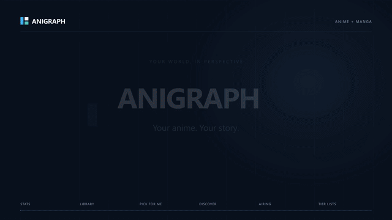

# 

**Your anime and manga library, in perspective.**

Anigraph turns public AniList and MyAnimeList profiles into a visual dashboard for
understanding your taste, finding your next title, and keeping your favorites together.
Explore your statistics, browse your collection, follow airing schedules, and build
character tier lists in one lightweight app.

**Vanilla JavaScript · No runtime dependencies**

**[Open Anigraph](https://anigraph-phi.vercel.app/)**

[Download MP4](https://github.com/neartana/Anigraph/raw/refs/heads/main/media/anigraph-showcase.mp4)
· [Download WebM](https://github.com/neartana/Anigraph/raw/refs/heads/main/media/anigraph-showcase.webm)
· [Motion source](media/showcase/README.md)
· [Get started](#quick-start)

The preview above plays directly in this README. For the full video, download either
format or clone the repository and open [media/index.html](media/index.html) in your browser.

## Features

| Feature | What you can do |
| --- | --- |
| **Stats** | Read scores, progress, statuses, formats, genres, and release/start years, with real cover artwork and a ranked titles view. |
| **Genre explorer** | Open a genre to see its titles from your public list, then filter by status or format and sort the results. |
| **My Library** | Search your complete returned anime or manga list; combine genre, year, format, status, and personal-score filters. |
| **Pick for Me** | Draw from your whole library or Planning list, with optional mood, genre, format, and length preferences. |
| **Discover** | Find titles outside your library using your highest-rated titles, favorite genres, and AniList community recommendations. |
| **Seasonal Explorer** | Browse anime by season and year, filter the catalog, and open titles on AniList. No profile required. |
| **Collections** | Create personal groups and save titles from Library, Discover, or Seasons in your browser. |
| **Airing Radar** | Browse a local-time weekly anime schedule, or use My Schedule for Watching, Repeating, and Planning anime in your library. |
| **Tier Lists** | Rank a title's characters with drag-and-drop or keyboard controls, save boards locally, and share a board through a link. |
| **News** | Read compact Anime News Network headlines and open each article at its original source. |

## Quick start

Install **Node.js 24 or newer**, then run:

~~~sh
git clone https://github.com/neartana/Anigraph.git
cd Anigraph
node server.js
~~~

Open **[http://127.0.0.1:5173](http://127.0.0.1:5173/)**. There is no `npm install`
or build command for the app. Choose AniList or MyAnimeList, enter a public username,
and select Anime or Manga.

To use another port in PowerShell:

~~~powershell
$env:PORT = '5174'
node server.js
~~~

The server binds to `127.0.0.1`. Internet access is needed for live profiles,
catalog data, artwork, fonts, and news.

### Running as a static site

AniList features also work on a plain static server or by opening `index.html` directly.
For example:

~~~sh
python -m http.server 5173 --bind 127.0.0.1
~~~

| Capability | Node server / Vercel | Static server / `file://` |
| --- | :---: | :---: |
| AniList profiles, Library, discovery, tiers, and Radar | Yes | Yes |
| MyAnimeList profiles and lists | Yes | No |
| Anime News Network headlines | Yes | No |

On static hosting, unavailable news is shown without blocking the other views. Some
browsers restrict clipboard access on `file://`; sharing falls back to a selectable link.

## Deploy to Vercel

The public app is hosted at **[anigraph-phi.vercel.app](https://anigraph-phi.vercel.app/)**.
The Vercel project is connected to this GitHub repository.

Import this repository into Vercel. The included configuration uses Node.js 24,
publishes the three app files through Vercel's CDN, and runs the existing MyAnimeList
and news proxies in a Node function. No environment variables are required.

For a command-line deployment after signing in:

~~~sh
npx vercel --prod
~~~

`npm run build` prepares the static `dist/` directory; `npm run test:vercel` checks
the deployment adapter, request validation, and published file allowlist. Local
development still uses `node server.js`. The motion showcase remains available in
the GitHub repository rather than the deployed app.

Proxy caches and upstream request queues are held in each warm function instance.
They reset on cold starts and are not shared across instances.

## Data and privacy

Anigraph reads **public data only**. No account connection, password, API key, or OAuth
login is required, and it does not update your AniList or MyAnimeList account.

- **AniList** supplies public profiles, catalog metadata, recommendations, characters,
  and airing schedules through its GraphQL API.
- **MyAnimeList** profiles and lists are read through the server proxy. Catalog
  discovery, character boards, and airing data still come from AniList. MAL title links
  open on MAL; catalog discoveries open on AniList.
- **Anime News Network** supplies headlines, excerpts, and optional thumbnails through
  a cached server proxy. Article links lead to the publisher.
- **Your browser** stores boards, collections, and interface preferences. There is no
  hosted database or cross-device sync. Clearing browser storage removes local saves.
  Shared board links contain the board snapshot, including character rankings.

Private or blocked lists are unavailable. Statistics and list counts can differ because
providers expose different public fields. Missing dates, lengths, or other metadata stay
unknown; a length-restricted pick excludes titles with unknown lengths. MyAnimeList's
public web endpoints may change, and airing schedules may be incomplete or revised.

## Development

The app uses classic HTML/CSS/JavaScript and a small Node server. Optional browser tests
use the existing Chrome DevTools Protocol harness; the motion renderer has its own
separate development dependencies.

~~~sh
node --check app.js
node --check server.js
node qa/server.mjs
node qa/news-images.mjs
~~~

See [Development notes](docs/DEVELOPMENT.md) for architecture, storage contracts, data
limits, and focused checks. The [QA guide](qa/README.md) documents browser prerequisites
and coverage. The [product brief](ANIGRAPH.md) includes the roadmap; roadmap items are
not all implemented.

| Path | Purpose |
| --- | --- |
| `index.html`, `styles.css`, `app.js` | Interface, charts, library, boards, and browser state |
| `server.js` | Local app server and fixed MAL/ANN proxy routes |
| `qa/` | Optional checks, browser harness, and frozen test fixtures |
| `media/` | Showcase video, player, preview, and editable motion source |

## Credits and license

Created by [neartana](https://github.com/neartana).

Original project code, documentation, motion graphics, and synthesized soundtrack are
available under the **[MIT License](LICENSE)**. Third-party anime/manga cover art,
character artwork, screenshots' embedded artwork, provider data, fonts, and trademarks
remain subject to their respective owners' rights and licenses; the MIT license does
not relicense those materials.

Data and artwork are supplied through [AniList](https://anilist.co/),
[MyAnimeList](https://myanimelist.net/), and
[Anime News Network](https://www.animenewsnetwork.com/). Typography uses Zen Kaku Gothic
New and JetBrains Mono via Google Fonts. Anigraph is an independent project and is not
affiliated with or endorsed by these services.
